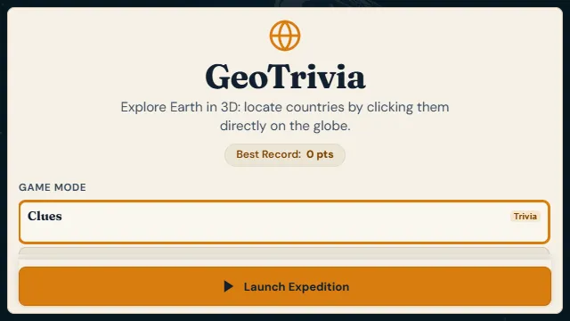

# Web Games

A collection of playable web games built with standard web technologies, featuring an interactive 3D globe geography trivia game and a 2D falling blocks arcade game.

[](LICENSE)
[](https://vaishnavkk.github.io/Games/)

No CDN or third-party requests at runtime; GeoTrivia bundles Three.js, and Matrixfall uses vanilla 2D Canvas and Web Audio.

---

## Games

| Name | What it is (one line) | Tech | Play | Source folder |
| :--- | :--- | :--- | :--- | :--- |
| **GeoTrivia: Earth Explorer**<br><br>[](https://vaishnavkk.github.io/Games/earth-trivia/) | Interactive 3D globe trivia identifying 195 sovereign nations directly on a Three.js Earth sphere | Three.js, TopoJSON, Web Audio | [Play GeoTrivia](https://vaishnavkk.github.io/Games/earth-trivia/) | [earth-trivia/](earth-trivia/) |
| **Matrixfall**<br><br>[](https://vaishnavkk.github.io/Games/matrix-fall/) | Falling blocks puzzle game with Matrix Surge bullet time, quantum phase blocks, and dynamic speed | HTML5 2D Canvas, Web Audio | [Play Matrixfall](https://vaishnavkk.github.io/Games/matrix-fall/) | [matrix-fall/](matrix-fall/) |

---

## Run Locally

### Prerequisites
Node.js version 20 is specified in [`.nvmrc`](.nvmrc).

### GeoTrivia
GeoTrivia uses esbuild to compile its modular client bundle:

```bash
# Navigate to GeoTrivia folder
cd earth-trivia

# Install dependencies and build bundle
npm ci
npm run build

# Start local development server (http://localhost:8080)
npm start
```

### Matrixfall
Matrixfall is standalone with zero dependencies or build steps:

```bash
# Navigate to Matrixfall folder
cd matrix-fall

# Open index.html directly in a browser
# Windows:
start index.html
# macOS:
open index.html

# Or serve via any HTTP server:
python -m http.server 8080
```

### Root Portal
To serve the complete arcade portal locally from the repository root:

```bash
# Build GeoTrivia first
npm --prefix earth-trivia ci
npm --prefix earth-trivia run build

# Start static server from root
python -m http.server 8080
# Visit http://localhost:8080 to access the arcade selector
```

---

## Project Structure

```
Games/
├── .github/                     # GitHub Actions CI workflows, issue templates, PR template
│   ├── ISSUE_TEMPLATE/          # Structured issue report templates
│   ├── pull_request_template.md # PR verification checklist
│   └── workflows/               # CI and scheduled source verification workflows
├── docs/                        # Project documentation and visual media assets
│   ├── img/                     # Game thumbnails captured from live game runs
│   └── social-preview.png       # 1280x640 OpenGraph repository preview card
├── earth-trivia/                # 3D interactive globe trivia game
│   ├── data/                    # Offline 195-nation dataset, TopoJSON, boundary vectors
│   ├── dist/                    # Bundled client distribution (esbuild)
│   ├── docs/                    # Architecture, data sources, and contributing guides
│   ├── scripts/                 # Build, validation, and automated self-play QA scripts
│   ├── src/                     # Game logic, Three.js scene, coordinate projection, audio
│   ├── test/                    # Unit, regression, and headless modal test suites
│   ├── vendor/                  # Self-hosted offline variable fonts and flag icons
│   ├── index.html               # Main entry HTML and HUD markup
│   ├── package.json             # Build commands, scripts, dependencies, engines
│   └── README.md                # GeoTrivia game architecture and mechanics guide
├── geotrivia/                   # Backward-compatibility HTTP redirect to earth-trivia/
│   └── index.html               # Client-side redirect stub
├── matrix-fall/                 # 2D canvas falling blocks arcade game
│   ├── index.html               # Self-contained game (Canvas, audio synth, responsive styles)
│   └── README.md                # Matrixfall mechanics, controls, and scoring guide
├── matrixfall/                  # Backward-compatibility HTTP redirect to matrix-fall/
│   └── index.html               # Client-side redirect stub
├── scripts/                     # Root test orchestration and self-play runners
│   ├── selfplay.js              # Multi-tier self-play delegation script
│   └── testTiers.js             # Question bag tier verification runner
├── .gitignore                   # Ignored files (node_modules, caches, reports, OS files)
├── .nvmrc                       # Node.js LTS version specification (v20)
├── index.html                   # Arcade portal homepage and game launcher
├── LICENSE                      # MIT Open Source License
├── package.json                 # Root script proxies for build, lint, and test suites
└── README.md                    # Repository index and overview documentation
```

---

## Quality

- **Continuous Integration**: GitHub Actions workflow [`.github/workflows/ci.yml`](.github/workflows/ci.yml) validates every push and pull request on Node 20. It builds `earth-trivia`, runs ESLint, executes offline data validators (`check:clues`, `check:palette`, `check:library`, `check:contrast`), runs unit tests, and launches Puppeteer smoke tests.
- **Automated Test Suite**: Unit and integration tests verify deterministic random selection, question bag exhaustion without replacement, camera framing math, coordinate raycasting, scoring calculations, and accessible modal navigation across multiple viewports. Run via `npm test` or `npm --prefix earth-trivia test`.
- **Autonomous Self-Play Harness**: An automated QA bot ([`earth-trivia/scripts/qa/selfplay.js`](earth-trivia/scripts/qa/selfplay.js)) uses Puppeteer to simulate real player sessions across desktop, tablet, and mobile viewports, evaluating full game cycles, edge-case clicks, and HUD updates. Run smoke tests locally with `npm run selfplay -- --smoke`.

---

## Contributing

Contributions are welcome. Please read the [Contributing Guide](earth-trivia/docs/CONTRIBUTING.md) for details on code style, clue factual requirements, and pre-commit validation gates.

Pull requests must pass all linters, data validators, unit tests, and self-play smoke tests before merging.

---

## License and Attributions

This repository is open-source software licensed under the [MIT License](LICENSE).

### Data Sources and Third-Party Assets
- **GeoTrivia**:
  - Cartography and Sovereign Boundaries: Natural Earth 1:50m vectors and Survey of India boundary alignments. Details and sources documented in [GeoTrivia Data Sources](earth-trivia/docs/DATA_SOURCES.md).
  - Upstream software and font notices are detailed in [GeoTrivia Third-Party Notices](earth-trivia/THIRD_PARTY_NOTICES.md).
- **Matrixfall**:
  - Standalone game with zero third-party assets; audio generated dynamically via Web Audio API. See the [Matrixfall Guide](matrix-fall/README.md).
