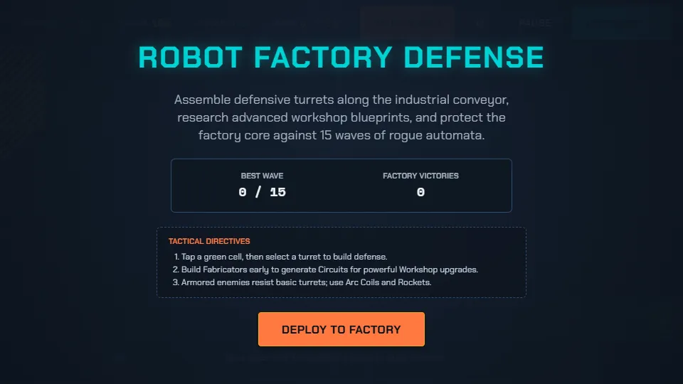
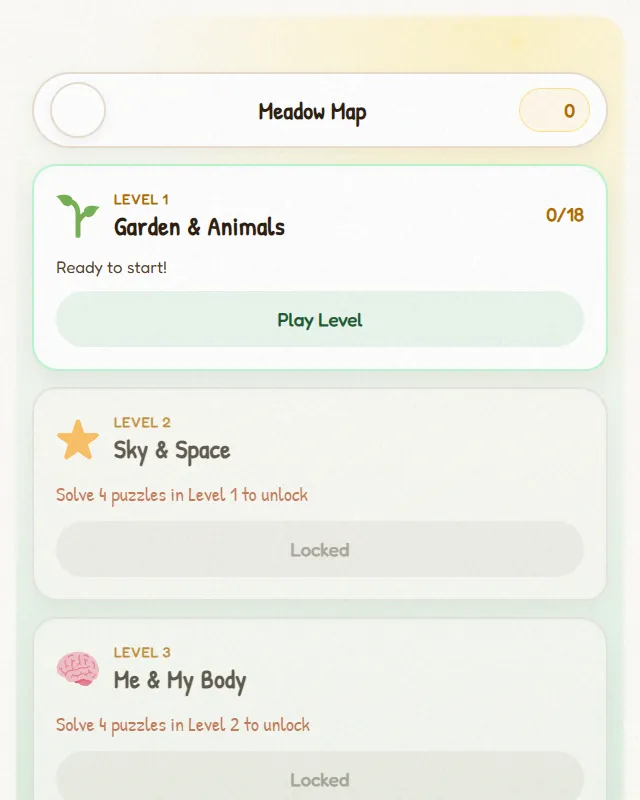
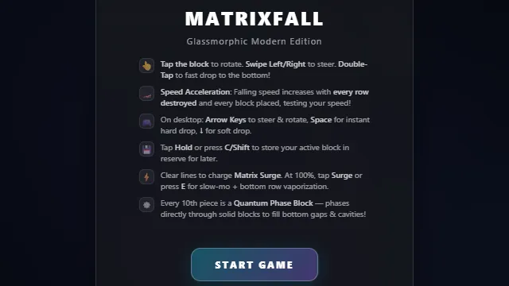

<div align="center">

# 🕹️ Web Games Arcade

**A curated collection of fast, lightweight, and responsive browser games.**  
Play instantly on desktop, tablet, or mobile — zero installs, no accounts, and no ads.

[](https://vaishnavkk.github.io/Games/)
[](LICENSE)
[](https://vaishnavkk.github.io/Games/)

<br />

> ### 🚀 [**Launch the Arcade Hub**](https://vaishnavkk.github.io/Games/)
> Experience all games with smooth audio, instant loading, and persistent local storage.

</div>

---

## 🎮 The Game Showcase

<table>
  <tr>
    <td width="50%" valign="top">
      <h3 align="center">🌍 GeoTrivia: Earth Explorer</h3>
      <div align="center">
        <a href="https://vaishnavkk.github.io/Games/earth-trivia/">
          
        </a>
      </div>
      <p><b>Interactive 3D Geography Trivia</b></p>
      <p>Spin a real-time rendered 3D globe and test your knowledge of 195 nations across continents using visual clues, national flags, capital cities, and geographical trivia.</p>
      <p>
        <a href="https://vaishnavkk.github.io/Games/earth-trivia/"><b>▶ Play GeoTrivia</b></a> • 
        <a href="earth-trivia/"><code>Source Code</code></a>
      </p>
    </td>
    <td width="50%" valign="top">
      <h3 align="center">🛡️ Robot Factory Defense</h3>
      <div align="center">
        <a href="https://vaishnavkk.github.io/Games/robot-factory-defense/dist/">
          
        </a>
      </div>
      <p><b>Tactical Sci-Fi Tower Defense</b></p>
      <p>Deploy specialized turrets, manage a dual economy (Scrap & Circuits), research permanent Workshop upgrades, and defend the Core through 15 waves of rogue automata and bosses.</p>
      <p>
        <a href="https://vaishnavkk.github.io/Games/robot-factory-defense/dist/"><b>▶ Play Robot Factory</b></a> • 
        <a href="robot-factory-defense/"><code>Source Code</code></a>
      </p>
    </td>
  </tr>
  <tr>
    <td width="50%" valign="top">
      <h3 align="center">🌿 Tricky Meadow</h3>
      <div align="center">
        <a href="https://vaishnavkk.github.io/Games/tricky-meadow/">
          
        </a>
      </div>
      <p><b>Cozy Nature & Science Puzzle Game</b></p>
      <p>A relaxing, beautifully illustrated puzzle adventure. Think outside the box, uncover nature's clever tricks, and learn fascinating wildlife facts as you explore.</p>
      <p>
        <a href="https://vaishnavkk.github.io/Games/tricky-meadow/"><b>▶ Play Tricky Meadow</b></a> • 
        <a href="tricky-meadow/"><code>Source Code</code></a>
      </p>
    </td>
    <td width="50%" valign="top">
      <h3 align="center">🟩 Matrixfall</h3>
      <div align="center">
        <a href="https://vaishnavkk.github.io/Games/matrix-fall/">
          
        </a>
      </div>
      <p><b>Cyberpunk Falling-Blocks Arcade</b></p>
      <p>Classic block-stacking arcade action infused with glowing retro neon CRT aesthetics, dynamic speed acceleration, and authentic synthesized sound effects.</p>
      <p>
        <a href="https://vaishnavkk.github.io/Games/matrix-fall/"><b>▶ Play Matrixfall</b></a> • 
        <a href="matrix-fall/"><code>Source Code</code></a>
      </p>
    </td>
  </tr>
</table>

---

## ✨ Features & Architecture Highlights

- ⚡ **Pure Client-Side**: 100% static HTML5, CSS3, and modern JavaScript (ES Modules).
- 📱 **Mobile & Touch First**: Fully responsive viewport scaling, calibrated touch zones, and tactile gestures.
- 🎨 **Original Visuals & Audio**: Procedural Canvas2D rendering, WebGL 3D shaders, and Web Audio API synthesis.
- 🔒 **Privacy Focused**: No tracking scripts, no third-party telemetry, no cookies, and no accounts.
- 💾 **Local Persistence**: Saves high scores, campaign unlock progress, and volume settings strictly to `localStorage`.

---

## 🛠️ Run Locally

You can spin up the entire game suite on your computer with a single terminal command:

```bash
# 1. Clone the repository
git clone https://github.com/vaishnavkk/Games.git
cd Games

# 2. Run any static server (Python or Node.js)
# Option A: Python 3
python -m http.server 8080

# Option B: Node.js (npx)
npx serve .
```

Open your browser at **`http://localhost:8080`** to browse and play.

---

## 📁 Repository Structure

```text
Games/
├── earth-trivia/           # 3D interactive globe geography game (Three.js / WebGL)
├── matrix-fall/            # Neon arcade falling-blocks puzzle game
├── tricky-meadow/          # Cozy science & nature puzzle game
├── robot-factory-defense/  # Deterministic tactical grid tower defense (Vite + Canvas2D)
├── docs/                   # Screenshots, balance telemetry, and visual assets
├── index.html              # Arcade hub homepage
└── README.md               # Repository documentation
```

---

## 📄 License

This repository is distributed under the open-source **[MIT License](LICENSE)**.  
You are welcome to explore the code, build upon it, and share the games!
