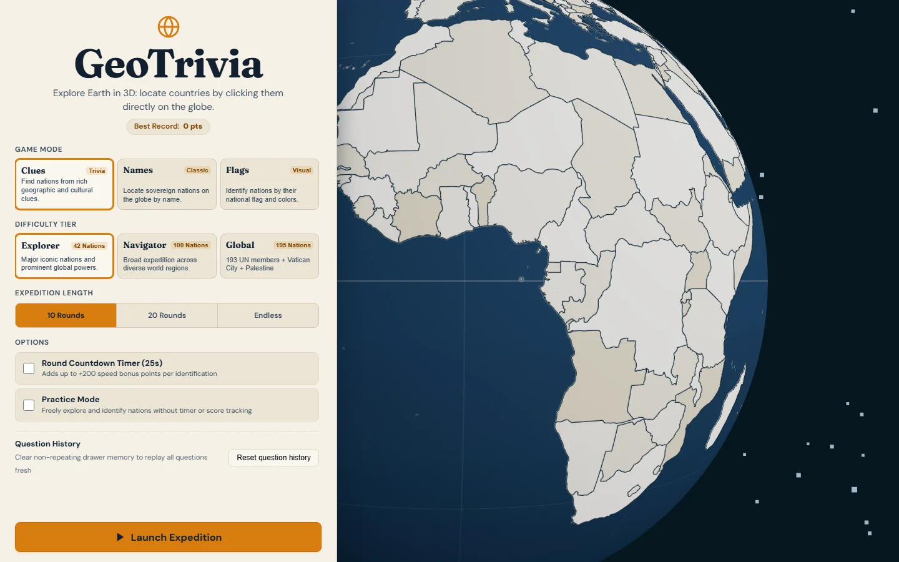
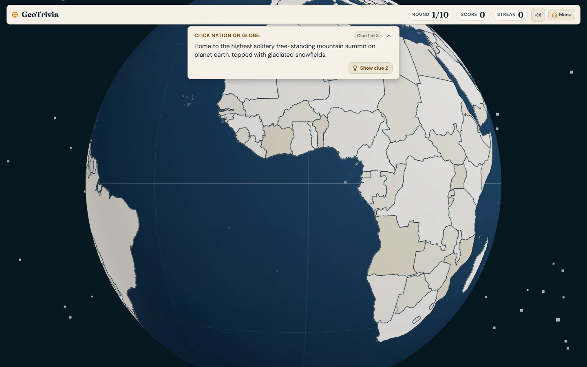
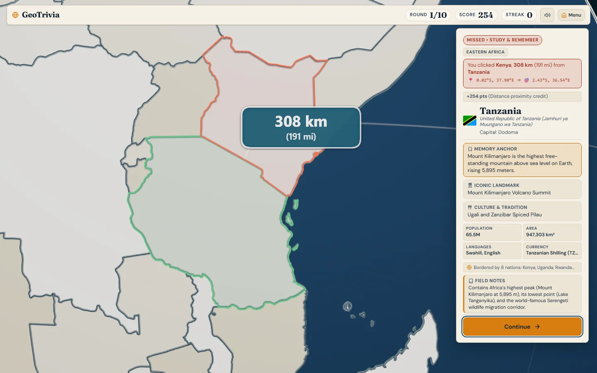
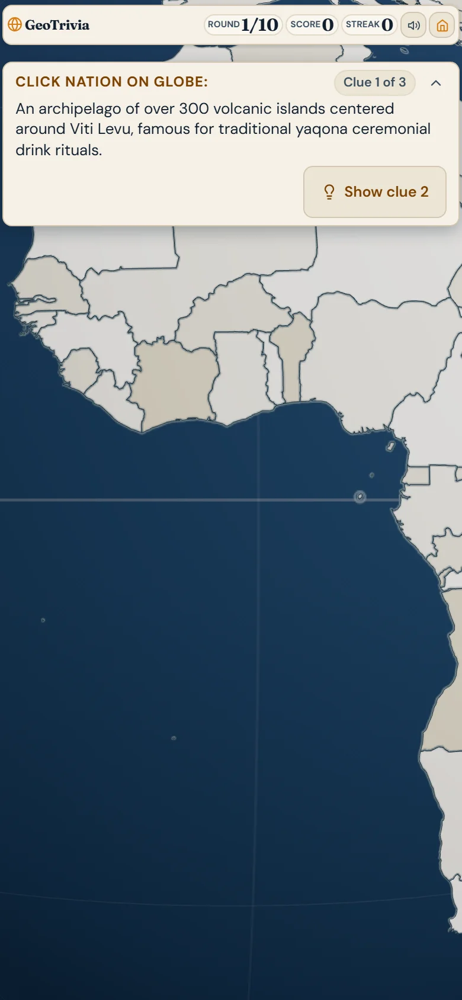
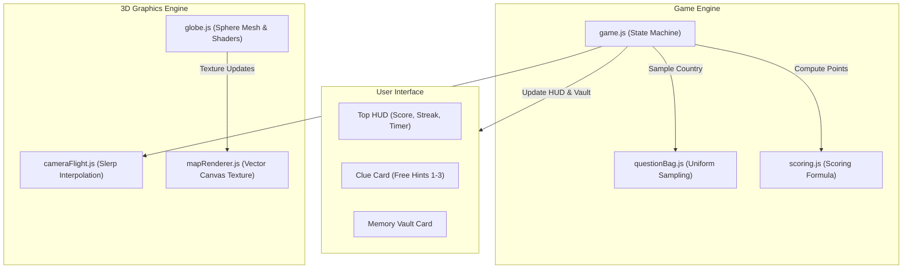

# 🌍 GeoTrivia: Earth Explorer

> **An interactive 3D WebGL globe geography trivia game where players identify nations by clicking directly on the 3D Earth.**

[](https://github.com/vaishnavkk/Games/actions/workflows/ci.yml)
[](https://vaishnavkk.github.io/Games/earth-trivia/)
[](https://threejs.org/)
[](https://developer.mozilla.org/en-US/docs/Web/JavaScript)
[](LICENSE)

---

## 🎮 Play Live
Experience the full 3D interactive globe directly in your browser:  
👉 **[Launch GeoTrivia: Earth Explorer](https://vaishnavkk.github.io/Games/earth-trivia/)**

---

## 📸 Screenshots

| Start Screen (Desktop) | Question Phase with Clue Card |
| :---: | :---: |
|  |  |

| Close-Miss Result with Geodesic Arc & Memory Vault | Mobile Responsive Experience (390×844) |
| :---: | :---: |
|  |  |

---

## ✨ Features & Highlights

- **Interactive 3D Earth Globe (`src/globe.js`, `src/mapRenderer.js`)**:
  - Offline vector rasterization of Natural Earth 50m TopoJSON onto high-resolution offscreen canvas textures (4096×2048 / 8192×4096).
  - OrbitControls with momentum damping, zoom bounds, atmosphere glow shader, and idle auto-rotation.
  - Dominates ≥75% of viewport across desktop, tablet, and mobile displays.
- **Accurate Direct Country Picking (`src/picker.js`)**:
  - Raycasts mouse or touch directly onto the 3D sphere.
  - Exact spherical-to-equirectangular coordinate projection:
    $$\text{lat} = \arcsin(y) \cdot \frac{180}{\pi}$$
    $$\theta = \text{atan2}(z, -x), \quad \text{lon} = \theta \cdot \frac{180}{\pi} - 180$$
  - Point-in-polygon ray-casting with bounding-box pre-filtering and antimeridian wrapping.
  - Precision beacon detection for **31 microstates and island nations** (Monaco, Singapore, Maldives, Malta, Vatican City, etc.).
- **Official Sovereign Boundaries (Survey of India Standards)**:
  - Integration of official Survey of India boundary vectors (`SOI_WEST_JK`, `SOI_NORTH_LADAKH`) into India's sovereign polygon (`IND`).
  - Seamless border alignment with neighbouring countries (Pakistan, China) with zero overlapping disputed strokes.
- **Cinematic Feedback & Geodesic Arcs (`src/cameraFlight.js`)**:
  - Smooth spherical linear interpolation (`slerp`) camera flight centering on target country.
  - If correct: nation illuminates in emerald green.
  - If incorrect: nation highlights in red, guess highlights in orange, and an elevated 3D **great-circle geodesic arc** connects the two points with a dynamic distance badge in kilometers and miles.
- **Educational Memory Vault Dossier (`src/ui.js`)**:
  - Unlocked after identification to permanently cement knowledge:
    - 🏛️ **Iconic Wonder**: UNESCO World Heritage landmarks.
    - 🍲 **Taste & Tradition**: Signature culinary heritage.
    - 🧠 **Memory Anchor**: Surprising historical milestones and cultural trivia.
    - 📋 **Full Dossier**: Official title, capital, population, area, languages, and neighbours.
  - One-click inspection links to **Google Maps** and **OpenStreetMap**.
- **Free Clue System & Zero-Spoiler Policy**:
  - 3 progressive clues per nation (heritage/culture ➔ geography/fauna ➔ landmark/modern).
  - All 3 clues can be revealed with **0 point penalty** (clues are 100% free).
  - Strict zero-geographical-spoiler rule: no continent names, compass directions, oceans, or mountain ranges.

---

## 🎯 How to Play

### 1. Game Modes
- **Clues Mode** (`clue`): Identify nations based on 3 progressive cultural, historical, and landmark clues.
- **Country Names Mode** (`name`): Test speed and geography knowledge with direct country names.
- **Flags Mode** (`flag`): Identify nations by their official sovereign flag.

### 2. Difficulty Tiers
- **Easy Tier** (**42 nations**, **534 verified clues**): Balanced global powers and iconic nations (11 Asia, 9 Africa, 10 Europe, 5 North America, 4 South America, 3 Oceania).
- **Medium Tier** (**100 nations**, **780 verified clues**): Well-known sovereign nations.
- **Hard Tier** (**195 nations**, **1089 verified clues**): Complete sovereign globe (193 UN members + Vatican City + Palestine).

### 3. Scoring Formula (`src/scoring.js`)
All scoring rules are implemented directly in `src/scoring.js`:
- **Base Correct Answer**: **800 points** (clues are free; zero deduction for revealing clues).
- **Timer Speed Bonus**: Up to **+200 points** proportional to remaining timer:
  $$\text{speedBonus} = \text{round}\left(200 \cdot \frac{t_{\text{remaining}}}{t_{\text{total}}}\right)$$
- **Streak Multiplier**: Consecutive correct answers boost your multiplier by $+0.1\times$ per answer, capped at **$1.5\times$** (achieved at streak 5):
  $$\text{multiplier} = \min(1.5, 1.0 + 0.1 \cdot \text{streak}_{\text{prior}})$$
- **Round Maximum Score**: Hard-capped at **1,000 points**:
  $$\text{RoundScore} = \min(1000, \text{round}((800 + \text{speedBonus}) \cdot \text{multiplier}))$$
- **Proximity Partial Credit**: If incorrect, guesses within $2,000\text{ km}$ receive partial credit:
  $$\text{partialCredit} = \text{round}\left(300 \cdot \max\left(0, 1 - \frac{d}{2000\text{ km}}\right)\right)$$
- **Timer**: 25-second countdown per round (can be toggled on/off in settings).
- **Practice Mode**: Untimed exploration with unrecorded scoring ($0\text{ pts}$).
- **Endless Expeditions**: Play continuously without round limits; finish at any point via the Finish Expedition dialog with comprehensive accuracy summary.

---

## 🏗️ System Architecture & Game Flow



---

## 🛠️ Project Structure

```
earth-trivia/
├── index.html                   # Clean semantic markup and module linkages
├── package.json                 # Build commands, scripts, dependencies & engines
├── LICENSE                      # MIT Open Source License (vaishnavkk)
├── THIRD_PARTY_NOTICES.md       # Full upstream dependency & font notices
├── data/                        # Verified offline datasets
│   ├── countries.json           # 195 sovereign nations metadata & anchors
│   ├── clues.json               # 1089 verified factual clues (695 source URLs)
│   ├── world-50m.js             # Natural Earth 50m TopoJSON + Survey of India boundaries
│   ├── tiny-countries.js        # Coordinates & beacon radii for 31 microstates
│   └── soi-boundaries.js        # Official Survey of India boundary vectors
├── dist/                        # Production build
│   └── bundle.js                # Optimized, minified ES module bundle (esbuild)
├── docs/                        # Architecture & contribution guides
│   ├── ARCHITECTURE.md          # Modular architecture, slerp math & round lifecycle
│   ├── DATA_SOURCES.md          # Dataset licenses, Survey of India notes & verification
│   ├── CONTRIBUTING.md          # Development setup, test gates & clue contribution rules
│   ├── social-preview.png       # 1280×640 social card
│   └── img/                     # Real Puppeteer game screenshots (WebP <= 150 KB)
│       ├── start-screen.webp
│       ├── question.webp
│       ├── close-miss.webp
│       └── mobile.webp
├── src/                         # Modular ES6 game source
│   ├── main.js                  # Entry point & global event coordination
│   ├── globe.js                 # Three.js 3D sphere, orbital controls & atmosphere
│   ├── mapRenderer.js           # 2D canvas cartography rasterizer
│   ├── picker.js                # Raycasting point-in-polygon & microstate hit detection
│   ├── cameraFlight.js          # Slerp flight, mid-range framing & distance badges
│   ├── game.js                  # Expedition loop, phase coordinator & mode switching
│   ├── scoring.js               # Points, timer bonus, streak multiplier & partial credit
│   ├── questionBag.js           # Uniform PRNG country sampling without replacement
│   ├── audio.js                 # Procedural Web Audio API sound synthesis
│   └── styles/                  # Modular stylesheets
└── test/                        # Automated unit, integration & modal layout test suite
```

---

## 💻 Development Commands

```bash
# Install dependencies
npm ci

# Build production bundle (dist/bundle.js)
npm run build

# Start local development server (http://localhost:8080)
npm start

# Run ESLint across src/
npm run lint

# Run all 8 data, clue, and UI contrast validators
npm run validate

# Run comprehensive test suite across 6 viewports
npm test

# Run autonomous Puppeteer self-play QA agent (smoke test)
npm run selfplay -- --smoke

# Run full self-play matrix across 3 seeds (123 games, 1,305 rounds)
npm run selfplay -- --full --workers=4
```

---

## 🧪 QA Approach & Verification Gates

GeoTrivia enforces strict automated quality gates:
1. **Autonomous Self-Play Harness (`scripts/qa/selfplay.js`)**: Puppeteer-driven autonomous QA agent that executes real games across 6 viewports (desktop, laptop, tablet, mobile), testing all game modes, tiers, and edge cases.
2. **Deterministic Randomness & Bag Exhaustion (`test/testRandom.js`, `test/testQuestionBag.js`)**: Seeded PRNG (`mulberry32`) ensures repeatable runs and verifies zero question repetition until tier exhaustion.
3. **Automated Clue & Claim Verification (`scripts/validate/checkClaims.js`)**: Validates every single clue in `data/clues.json` to ensure 100% of years, numbers, and proper nouns are directly backed by cited source sentences.
4. **Modal Layout & A11y Invariants (`test/testModals.js`)**: Verifies focus traps, ESC key handling, backdrop dismissal, and zero clipped text across 6 viewports ($320\times568$ to $1920\times1080$).

---

## 📚 Data Sources & Attributions

- **Cartography**: Natural Earth 1:50m Cultural Vectors (Public Domain) via `world-atlas` (ISC License, Michael Bostock).
- **Sovereign Boundaries**: Survey of India official boundary vectors integrated via DataMeet Open Spatial Repository.
- **Encyclopedic Facts**: Wikipedia and UNESCO World Heritage documentation (CC BY-SA 4.0).
- **Typography**: Fraunces Variable and DM Sans Variable fonts (SIL Open Font License 1.1).
- **3D Engine**: Three.js (MIT License, Copyright © 2010-2025 three.js authors).

*Full licensing disclosures, copyright notices, and honest boundary notes in [docs/DATA_SOURCES.md](docs/DATA_SOURCES.md) and [THIRD_PARTY_NOTICES.md](THIRD_PARTY_NOTICES.md).*

---

## 🗺️ Roadmap (v1.1)

- **Expanded Clue Quotas**: Expand Medium tier to ≥1,000 clues and Hard tier to ≥1,500 clues with continuous sentence-level claim verification.
- **Map & Distance Label Polish**: Add high-contrast leader lines for closely clustered island microstates (Caribbean and South Pacific).
- **Audio Synthesizer Extensions**: Add optional microtonal regional scales to procedural audio synthesis based on identified continents.
- **Offline PWA Support**: Service worker caching of 3D globe assets for 100% offline gameplay.

---

## 📄 License

GeoTrivia: Earth Explorer is open-source software licensed under the [MIT License](LICENSE).  
Copyright © 2026 vaishnavkk.
