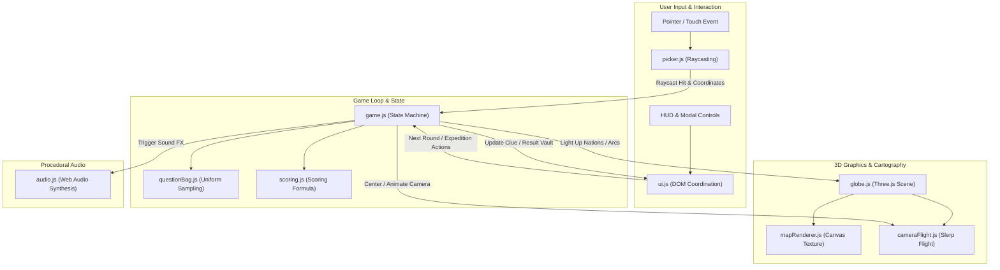
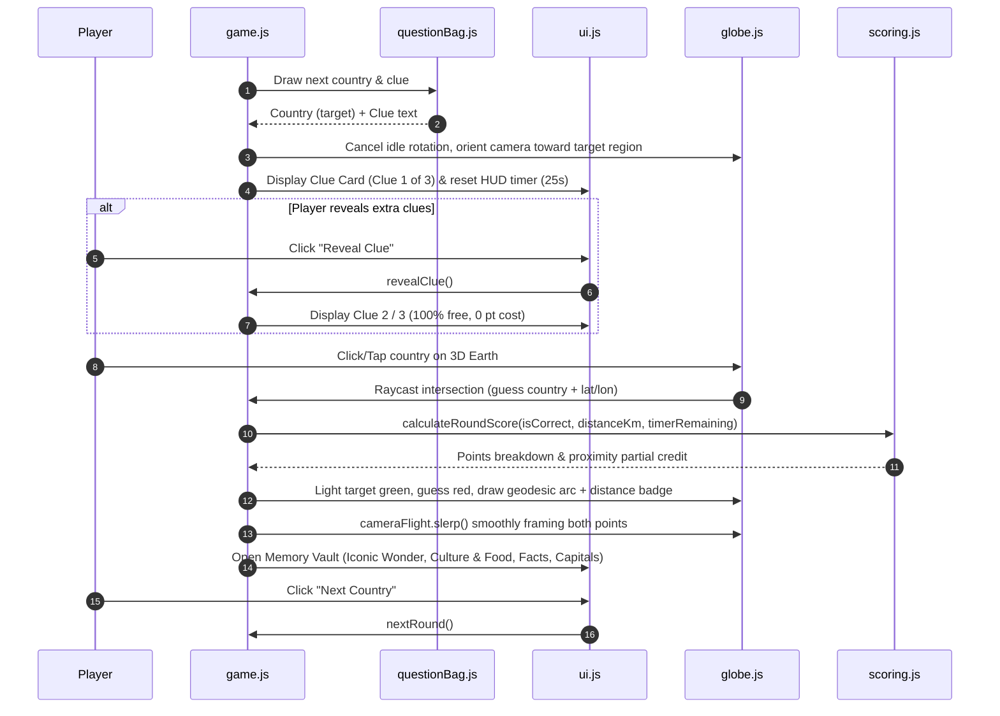

# GeoTrivia: Architecture & System Design

This document details the modular architecture, data flow, spatial math, camera flight interpolation, scoring algorithms, and round lifecycle of **GeoTrivia: Earth Explorer**.

---

## 1. High-Level System Architecture

GeoTrivia is structured as a zero-dependency client-side WebGL application built on ES6 modules and bundled via `esbuild`. The architecture separates rendering, spatial raycasting, game state, audio synthesis, and HUD presentation into focused modules.

---

## 2. Core Modules Breakdown

### A. 3D Graphics & Projection Layer
- **`src/globe.js`**:
  - Initializes Three.js scene, WebGLRenderer, orbital camera, and custom atmosphere glow rim shader.
  - Generates the primary Earth sphere mesh textured with the dynamic 2D canvas created by `mapRenderer.js`.
  - Coordinates idle auto-rotation, smooth damping controls, and great-circle geodesic arc rendering (`drawArc()`).
- **`src/mapRenderer.js`**:
  - Offline vector cartography engine. Converts GeoJSON/TopoJSON polygons from `data/world-50m.js` into equirectangular pixel coordinates ($4096 \times 2048$ or $8192 \times 4096$).
  - Rasterizes country polygons, maritime boundaries, land fills, and country stroke highlights onto an offscreen canvas.
  - Updates country colors dynamically when an answer is submitted (e.g. emerald green for correct, ruby red for incorrect guess).
- **`src/cameraFlight.js`**:
  - Drives cinematic orbital camera transitions using spherical linear interpolation (`slerp`).
  - Implements smart mid-range framing (`frame_union.js`) ensuring that both target and guess countries remain fully visible without being obscured by floating UI modals or bottom cards across all viewports.
  - Projects high-DPI distance badges dynamically onto the globe along geodesic arcs.

### B. Spatial Detection & Picking
- **`src/picker.js`**:
  - Casts a ray from camera through normalized device pointer coordinates $(x, y)$ onto the 3D unit sphere.
  - Converts the 3D intersection point $(X, Y, Z)$ to spherical latitude and longitude:
    $$\text{lat} = \arcsin(Y) \cdot \frac{180}{\pi}$$
    $$\theta = \text{atan2}(Z, -X), \quad \text{lon} = \theta \cdot \frac{180}{\pi} - 180$$
  - Performs multi-polygon point-in-polygon raycasting with bounding-box pre-filtering and international date-line wrapping.
  - Implements enlarged hit beacons for 31 microstates and island nations (`data/tiny-countries.js`).

### C. Game Loop & State Machine
- **`src/game.js`**:
  - Coordinates expedition modes (`clue`, `name`, `flag`), difficulty tiers (`easy`, `medium`, `hard`), timer countdowns (25 seconds), and round lifecycles.
  - Manages round phases: `start` ➔ `question` ➔ `answering` ➔ `result` ➔ `summary`.
- **`src/questionBag.js`**:
  - Enforces uniform without-replacement sampling over the active tier's country bag using seeded PRNG (`rng.js`, `mulberry32`).
  - Prevents question repetition until the entire country library for that tier has been exhausted.
- **`src/scoring.js`**:
  - Single source of truth for point calculations, time bonuses, streak multipliers, and proximity partial credit.

### D. Audio & Interface
- **`src/audio.js`**:
  - Synthesizes 100% procedural sound effects via the browser's Web Audio API (`AudioContext`).
  - Produces custom sound profiles for clicks, clue reveals, correct chime bursts, wrong buzzers, and expedition fanfare. Zero external MP3/WAV audio files.
- **`src/ui.js`**:
  - Manages HUD elements, top timer bar, clue cards, the educational Memory Vault dossier, start settings modal, and end-of-expedition summary screens.

---

## 3. How a Round Works: Lifecycle Step-by-Step

---

## 4. Camera Flight & Spatial Math

### Spherical-to-Cartesian & Cartesian-to-Spherical
For latitude $\phi \in [-90^\circ, 90^\circ]$ and longitude $\lambda \in [-180^\circ, 180^\circ]$:
$$X = R \cdot \cos(\phi) \cdot \sin(-\lambda)$$
$$Y = R \cdot \sin(\phi)$$
$$Z = R \cdot \cos(\phi) \cdot \cos(-\lambda)$$

### Great-Circle Geodesic Distance
Distance between two points $(\phi_1, \lambda_1)$ and $(\phi_2, \lambda_2)$ on a sphere with radius $R = 6,371\text{ km}$:
$$\Delta \sigma = 2 \arcsin \sqrt{\sin^2\left(\frac{\Delta \phi}{2}\right) + \cos(\phi_1)\cos(\phi_2)\sin^2\left(\frac{\Delta \lambda}{2}\right)}$$
$$d = R \cdot \Delta \sigma$$

### Camera Slerp Framing
When centering between two points (target and guess):
1. Compute midpoint along the great-circle arc.
2. Determine required camera distance $D$ using bounding angular span $\alpha$:
   $$D = \max\left(D_{\min}, \frac{R}{\sin(\alpha / 2)}\right)$$
3. Execute smooth spherical linear interpolation (`slerp`) with cubic ease-out over 800–1200 ms.

---

## 5. Scoring System

Implemented in `src/scoring.js`:

- **Correct Answer Base Points**: $800\text{ pts}$ (clues are free; zero point penalty for revealing all 3 clues).
- **Timer Speed Bonus**: Up to $+200\text{ pts}$ proportional to remaining time:
  $$\text{speedBonus} = \text{round}\left(200 \cdot \frac{t_{\text{remaining}}}{t_{\text{total}}}\right)$$
- **Streak Multiplier**:
  $$\text{multiplier} = \min(1.5, 1.0 + 0.1 \cdot \text{streak}_{\text{prior}})$$
  Reaches maximum $1.5\times$ at a streak of 5.
- **Round Maximum Score**: Hard-capped at $1,000\text{ pts}$:
  $$\text{RoundScore} = \min\left(1000, \text{round}\left((800 + \text{speedBonus}) \cdot \text{multiplier}\right)\right)$$
- **Wrong Answer Proximity Partial Credit**:
  Awarded if player's guess is within $2,000\text{ km}$ of the target country:
  $$\text{partialCredit} = \text{round}\left(300 \cdot \max\left(0, 1 - \frac{d}{2000\text{ km}}\right)\right)$$
- **Practice Mode**: Unlimited time, unrecorded scoring ($0\text{ pts}$).
