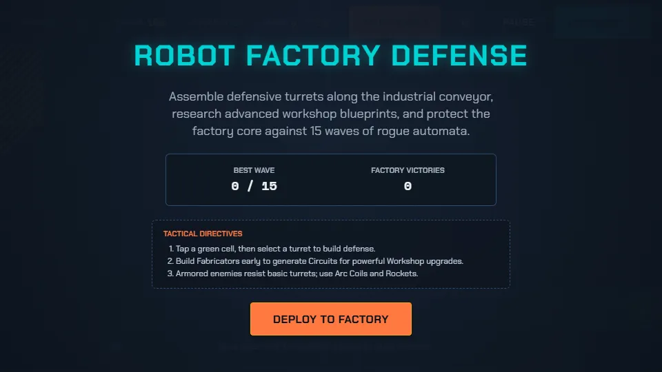

<div align="center">

# 🤖 Robot Factory Defense

**A deterministic tactical sci-fi grid tower defense game built for the web.**  
Deploy specialized turrets, manage a dual resource economy, unlock permanent Workshop upgrades, and defend the core through 15 waves of rogue automata.

[](https://vaishnavkk.github.io/Games/robot-factory-defense/dist/)
[](../LICENSE)
[](package.json)
[](src/)

<br />

<a href="https://vaishnavkk.github.io/Games/robot-factory-defense/dist/">
  
</a>

<br /><br />

> ### ⚡ [**Play Robot Factory Defense in Your Browser**](https://vaishnavkk.github.io/Games/robot-factory-defense/dist/)
> High-performance 60 FPS deterministic canvas simulation with full audio synthesizer effects.

</div>

---

## 🎯 Gameplay & Key Features

### ⚙️ Dual-Resource Economy
- 🔩 **Scrap**: The primary industrial currency dropped by eliminated enemies and recovered via demolition refunds. Spend Scrap on turret placements, level upgrades, and auxiliary Fabricators.
- 💡 **Circuits**: Precision computational components generated passively by active Fabricators ($1\text{ Circuit} / 10\text{ seconds}$). Circuits unlock advanced tech trees (Arc Coil, Rocket Pod) and fund permanent global Workshop upgrades.

### 🛡️ Defensive Arsenal

| Turret | Scrap Cost | Circuit Tech | Function & Combat Specialty |
| :--- | :---: | :---: | :--- |
| **Pulse Turret** | `60 🔩` | Free | Rapid-fire kinetic cannon; ideal for early waves and picking off agile runners. |
| **Coolant Sprayer** | `80 🔩` | Free | Cryogenic foam projector that reduces enemy speed by 50% for 2.0s (non-stacking). |
| **Arc Coil** | `100 🔩` | `20 💡` | High-voltage electric beam chaining across up to 3 nearby units, **completely bypassing armor**. |
| **Rocket Pod** | `105 🔩` | `20 💡` | Heavy ballistic artillery firing cluster missiles that deal massive area-of-effect splash damage. |
| **Fabricator** | `75 🔩` | Free *(Max 4)* | Autonomous production unit generating 1 Circuit every 10 seconds to fuel tech progression. |

---

### 👾 Rogue Automata & Boss Encounters

- **Glitchbot**: High-velocity scout deployed in rapid swarm clusters.
- **Rust Walker**: Armored frontline soldier resistant to light kinetic projectiles.
- **Spark Drone**: Fast hovering automaton flying over track hazards with elevated health.
- **Crusher Tank**: Heavy siege vehicle with reinforced plating (deals 3 Core breach damage).
- **Iron Sentry (Wave 10 Mini-Boss)**: Armed with an EMP pulse that temporarily shuts down nearby defenses (deals 5 Core damage).
- **Mega Mixer (Wave 15 Final Boss)**: Multi-phase industrial terror protected by a reactive kinetic shield (deals 10 Core damage).

---

### 🔬 The Engineering Workshop
Upgrade permanent factory capabilities mid-campaign using collected Circuits:

- ⚡ **Overclock**: Boosts base firing cadence across all placed defensive structures.
- 💥 **Hardened Rounds**: Amplifies projectile kinetic and explosive impact damage.
- 🔭 **Long Barrels**: Extends operational sensor range for all weapon platforms.
- 🧲 **Scrap Magnet**: Maximizes salvage yield from all destroyed enemy hulls.
- 🔧 **Repair Bay**: Automatically reconstructs damaged Core structural integrity between waves.
- ⏱️ **Fast Assembly**: Streamlines manufacturing pipelines, reducing build costs for future placements.

---

## 🏗️ Technical Architecture & Design

- **Engine-Free Rendering**: 100% custom HTML5 Canvas2D renderer. Zero external game frameworks, physics libraries, or sprite assets.
- **Deterministic State Loop**: Fixed 60-tick/sec deterministic simulation engine where identical seeds and inputs guarantee bit-identical outcomes.
- **Web Audio Synthesis**: Fully procedural audio synthesis pipeline using Web Audio API oscillators and gain envelopes.
- **Strict Verification Suite**: Tested with 79 comprehensive tests including Red Team exploits, property-based invariants, and Monte Carlo automated bot selfplay.

---

## 💻 Local Development & Testing

```bash
# Navigate to the game directory
cd robot-factory-defense

# Install development dependencies
npm install

# Start local dev server with hot module reload
npm run dev

# Run full test suite (79/79 unit and invariant tests)
npm test

# Run ESLint validation
npm run lint

# Build production bundle
npm run build
```

---

## 📚 Technical Documentation

Explore the comprehensive engineering documentation in [`docs/`](docs/):
- 📐 [**Design Specification**](docs/DESIGN.md) — Mathematical formulas, damage formulas, and wave density curves.
- 📜 [**Interface Contract**](docs/CONTRACT.md) — Deterministic simulation API, state snapshots, and event contracts.
- 🧪 [**Test Plan**](docs/TESTPLAN.md) — Invariants, automated bot matrix, and verification gates.
- 📊 [**Balance Calibration**](docs/BALANCE.md) — Monte Carlo win rate benchmarks across 300 calibrated seeds.
- 🏛️ [**Stack & Architecture**](docs/STACK.md) — Zero-dependency architecture analysis and licensing audit.

---

## 📄 License

This project is licensed under the [MIT License](../LICENSE).
