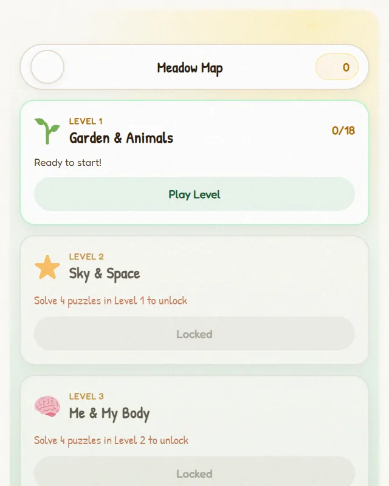

# Tricky Meadow

A gentle, clever trick-puzzle game designed for curious kids (ages 6–10). Explore a warm Ghibli-inspired watercolor meadow, solve science and nature trick puzzles where the obvious answer is often wrong, and uncover real science facts with **Moss**, your friendly leaf-sprite companion.

---

## Screenshots

| Meadow Map | Puzzle & Fact Card |
| :---: | :---: |
|  |  |

---

## What It Is

Tricky Meadow features **72 verified educational trick-puzzles** across three levels (24 per level):

1. **Garden & Animals** — insects vs. arachnids, egg-laying animals, fungi, life cycles, and animal adaptations
2. **Sky & Space** — Venus's greenhouse heat, the Sun as a star, Moon phases and gravity, planetary rings, day/night rotation, and the water cycle
3. **Me & My Body** — baby vs. adult bones, skin as the largest organ, tooth enamel hardness, inner-ear balance, muscles, blood, and senses

Puzzles come in three tap-only formats (`38` Pick, `18` Tap All, `16` Order), with crypto-seeded render-time item shuffling so card positions vary across runs:

- **Pick**: Choose 1 of 3–4 illustrated cards.
- **Tap All**: Tap every card that fits the rule, then tap **Done**.
- **Order**: Tap cards in their true scientific sequence (tap a numbered card again to undo).

Every puzzle reveals a **"Did You Know?"** fact card supported by reputable institutional sources (NASA Space Place, Solar System Exploration, and GPM; Smithsonian's National Zoo; NOAA; National Park Service; NIH MedlinePlus, NHLBI, NIAMS, and NIDCD; ASU Ask A Biologist; University Extensions; and ADA MouthHealthy).

---

## How to Play

1. **Pick a Level**: Start at Level 1 (*Garden & Animals*). Solve **4 puzzles** in a level to unlock the next level.
2. **Think Carefully**: Obvious answers might be tricks! Count insect legs or remember which planet traps the most heat.
3. **Earn Stars**:
   - ⭐⭐⭐ **3 Stars**: Solved on your first try without a hint.
   - ⭐⭐ **2 Stars**: Used a hint or solved on your second try.
   - ⭐ **1 Star**: Revealed gently after two incorrect attempts.
4. **Gentle Feedback**: No countdown timers, no failure screens, and no harsh buzzers — just a gentle card wobble, warm encouragement from Moss, and full `prefers-reduced-motion` support.
5. **Speech Support**: Tap the speaker button to hear the prompt and card labels read aloud using the browser's Web Speech API.

---

## Privacy & Child Safety

- **100% Offline & Client-Side**: Bundled fonts (`@fontsource/fredoka`, `@fontsource/patrick-hand`) and inline SVG sprites mean zero runtime CDN calls, zero tracking, zero ads, and no accounts.
- **Scoped Local Progress**: Star progress is saved locally in `localStorage` under `tricky-meadow:save_v1` (with an automatic in-memory fallback if storage is blocked) and can be cleared from **Settings & Credits** using the 2-second hold-to-reset button.
- **No Outbound Links for Children**: On the in-game **Settings & Credits** screen, all **Credits & Attributions** and **Fact Sources (Parents & Educators)** entries are displayed strictly as plain text with no external hyperlinks.

---

## Run Locally

Requires **Node.js `>= 20.0.0`**.

```bash
# Clone the repository
git clone https://github.com/vaishnavkk/Games.git
cd Games/tricky-meadow

# Install dependencies
npm ci

# Start the Vite development server
npm run dev

# Build the sprite and production bundle (outputs to dist/)
npm run build

# Preview the production bundle locally
npm run preview
```

### Verification & QA Scripts

```bash
npm test                # Run Node unit, gameplay, shuffle, smoke, and regression tests (test/**/*.test.js)
npm run lint            # Run ESLint across src/
npm run check:puzzles   # Validate puzzle schema, reading level, CLDR icons, myths, and planted defect checks
npm run check:sources   # Verify single-sentence source evidence matching against institutional source pages
npm run selfplay        # Run autonomous 9-viewport headless Chrome/Puppeteer self-play QA against dist/
```

---

## Project Structure

`src/sprite.js` is generated at build time by `scripts/build-sprite.js` from `src/data/ui-icons.js`, `src/data/puzzles.json`, `LEVELS` in `src/engine/game.js`, `@twemoji/svg`, and custom SVGs in `src/assets/svg/`.

```text
tricky-meadow/
├── CHANGELOG.md                # Release history (through v0.3.5)
├── LICENSE                     # MIT License
├── README.md                   # Project documentation
├── THIRD_PARTY_NOTICES.md      # Open-source & dataset attributions
├── eslint.config.js            # ESLint flat configuration for src/
├── index.html                  # Vite entry point & Pages root redirect
├── package.json                # Dependencies, Node engine, and npm scripts
├── vite.config.js              # Vite config (base './', dist output, redirect strip on build)
├── dist/                       # Production bundle (HTML, JS, CSS, bundled fonts)
├── docs/
│   ├── DECISIONS.md            # Architecture, design & ambiguity decisions
│   ├── STACK.md                # Technology stack & license rationale
│   └── img/
│       ├── fact-card.webp      # Fact card screenshot
│       └── map.webp            # Meadow Map screenshot
├── report/
│   └── content/                # Content audit & source evidence reports
│       ├── ambiguity.txt
│       ├── audit.txt
│       └── support.txt
├── scripts/
│   ├── build-sprite.js         # Generates src/sprite.js from Twemoji + custom SVGs
│   ├── capture-screens.js      # Automated WebP screenshot capture against dist/
│   ├── check-puzzles.js        # Schema, reading-level, CLDR icon & myth validator
│   ├── check-sources.js        # Institutional source citation & evidence validator
│   ├── chrome.js               # Headless Chrome executable & launch helper
│   └── selfplay.js             # Autonomous 9-viewport Puppeteer QA harness
├── src/
│   ├── assets/
│   │   └── svg/                # Custom handcrafted SVGs
│   │       ├── chrysalis.svg
│   │       ├── inner-ear.svg
│   │       └── jupiter.svg
│   ├── data/
│   │   ├── allowed-terms.json  # Approved domain science vocabulary
│   │   ├── cldr-keywords.json  # Unicode CLDR emoji keyword lookup
│   │   ├── common-words-5000.json
│   │   ├── myths.json          # Science misconception guard list
│   │   ├── puzzles.json        # 72 verified trick-puzzles (24 per level)
│   │   ├── reviewed-icons.json # Explicitly reviewed emoji overrides
│   │   └── ui-icons.js         # UI icon emoji registry
│   ├── engine/
│   │   ├── game.js             # GameManager state machine, shuffle & confetti
│   │   ├── scoring.js          # Star scoring, level unlocks & answer checking
│   │   └── storage.js          # Namespaced localStorage with sanitization & fallback
│   ├── ui/
│   │   ├── escape.js           # Safe HTML interpolation helper
│   │   ├── mascot.js           # Mascot "Moss" SVG (neutral, cheer, think)
│   │   ├── screens.js          # Screen renderers (Home, Map, Puzzle, Fact, Level Done, Settings)
│   │   └── speech.js           # Safe Web Speech API read-aloud helpers
│   ├── main.js                 # App bootstrap, event delegation & reset hold timer
│   ├── sprite.js               # Generated in-DOM SVG sprite & renderEmoji helper
│   └── style.css               # Watercolor styling, layout & reduced-motion rules
└── test/
    ├── engine.test.js          # Scoring, unlock, answer check & storage tests
    ├── gameplay.test.js        # All-72-puzzle playthrough, shuffle & input-lock tests
    ├── shuffle.test.js         # Shuffle uniformity & order never-identity tests
    ├── smoke.test.js           # Scaffold & dependency smoke tests
    └── unit/
        └── regression.test.js  # Regression suite (storage, timers, XSS, speech, DOM)
```

---

## Credits & Attributions

- **Illustrations**: Twemoji graphics by Twitter / X contributors (`@twemoji/svg`), licensed under [CC-BY 4.0](https://creativecommons.org/licenses/by/4.0/), plus custom handcrafted SVGs in `src/assets/svg/`.
- **Typography**: Fredoka by Milena Brandao (`@fontsource/fredoka`) and Patrick Hand by Patrick Wagesreiter (`@fontsource/patrick-hand`), licensed under the [SIL Open Font License 1.1](https://openfontlicense.org).
- **Celebrations**: `canvas-confetti` by Kiril Vatev, licensed under the [ISC License](https://opensource.org/licenses/ISC).
- **Validation Datasets**: Top 5,000 common English words (`google-10000-english`) and Unicode CLDR emoji annotations (`emojilib`).

See [THIRD_PARTY_NOTICES.md](THIRD_PARTY_NOTICES.md) for full license texts and notices, [docs/STACK.md](docs/STACK.md) for technology choices, and [CHANGELOG.md](CHANGELOG.md) for release history.

---

## Future Ideas

- **More Levels**: Ocean Depths, Dino Digs, and Microscopic Wonders.
- **Procedural Sound**: Gentle Web Audio API chimes and nature ambiance.
- **Translations**: Multilingual puzzle packs and read-aloud support.
- **Parent Corner**: Discussion prompts to explore each science fact together after solving.

---

## License

[MIT License](LICENSE) • Copyright (c) 2026 vaishnavkk
