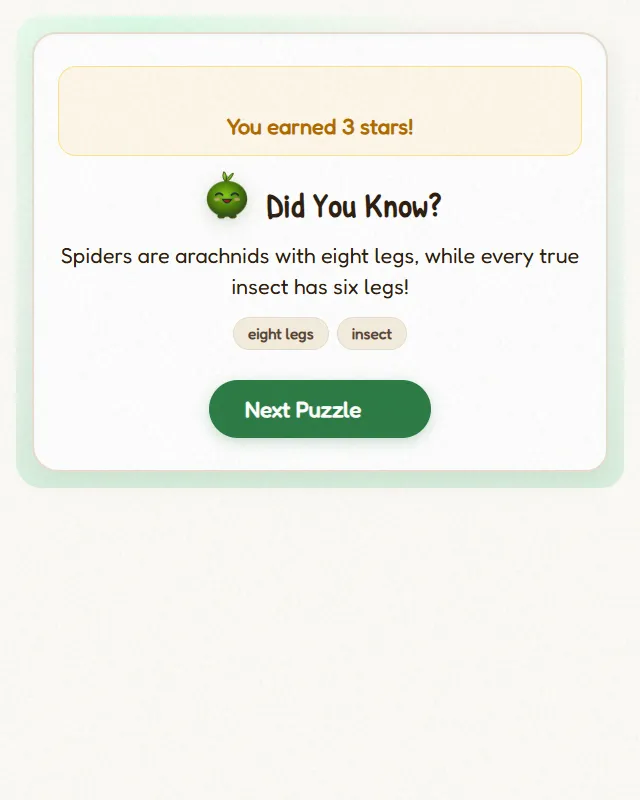

# Tricky Meadow

A gentle, clever trick-puzzle game designed for curious kids (ages 6–10). Explore a warm Ghibli-inspired watercolor meadow, solve science and nature trick puzzles where the obvious answer is often wrong, and uncover real textbook facts with **Moss**, your friendly leaf-sprite companion.

---

## Screenshots

| Meadow Map | Puzzle & Fact Card |
| :---: | :---: |
|  |  |

---

## What It Is

Tricky Meadow features 18 carefully verified educational trick-puzzles across three levels:
1. **Garden & Animals** (insects vs. arachnids, egg-laying mammals, fungi, life cycles)
2. **Sky & Space** (the hottest planet, light reflection, planetary rings, inner solar system)
3. **Me & My Body** (baby vs. adult bones, human skin as largest organ, tooth enamel hardness, sensory organs)

Puzzles come in three tap-only formats:
- **Pick**: Choose 1 of 3–4 illustrated cards.
- **Tap All**: Tap every card that fits the rule, then tap Done.
- **Order**: Tap cards in their true scientific sequence (e.g., life stages, planet distances).

Every puzzle reveals a fascinating **"Did You Know?"** fact card backed by reputable institutions (NASA Space Place, Smithsonian National Zoo, NOAA, NPS, NIH/MedlinePlus).

---

## How to Play

1. **Pick a Level**: Start at Level 1 (*Garden & Animals*). Solve 4 of 6 puzzles to unlock the next level.
2. **Think Carefully**: Obvious answers might be tricks! Count insect legs or remember which planet has a thick atmosphere.
3. **Earn Stars**:
   - ⭐⭐⭐ 3 Stars: Solved on your first try without hints.
   - ⭐⭐ 2 Stars: Used a hint or solved on your second try.
   - ⭐ 1 Star: Revealed after two gentle attempts.
4. **Gentle Feedback**: No scary timers, no red failure screens, and no negative buzzers. Just gentle wobbles and warm encouragement.
5. **Speech Support**: Tap the speaker icon to hear the prompt read aloud.

---

## Privacy & Child Safety

- **100% Offline & Private**: No tracking, no accounts, no network requests; progress stays in your browser.
- **No Third-Party Links for Children**: Educational source references are listed strictly as plain text on the Credits page without external hyperlinks.

---

## Run Locally

```bash
# Clone the repository
git clone https://github.com/vaishnavkk/Games.git
cd Games/tricky-meadow

# Install dependencies (Node >= 20)
npm ci

# Run development server
npm run dev

# Run verification checks
npm run check:puzzles   # Validates puzzle schema, word limits, and Twemoji SVGs
npm run check:sources   # Verifies single-sentence evidence matching from source pages
npm run lint            # ESLint audit
npm test                # Unit test suite (stars, unlocks, answers, storage)
npm run selfplay        # Autonomous 3-viewport headless Puppeteer self-play harness

# Production build
npm run build
```

---

## Project Structure

```text
tricky-meadow/
├── index.html              # Vite entry point & production redirect
├── package.json            # Scripts and dependencies
├── vite.config.js          # Build configuration (base './', outDir 'dist')
├── dist/                   # Production bundle (HTML, JS, CSS, fonts, SVG sprite)
├── docs/
│   ├── DECISIONS.md        # Architectural decision records
│   └── img/                # Verified game screenshots (640px WebP)
├── public/
│   └── sprite.svg          # Dynamic build-time Twemoji SVG sprite
├── scripts/
│   ├── build-sprite.js     # Extracts referenced emojis and builds optimized SVG sprite
│   ├── check-puzzles.js    # Schema, length, and banned-word validator
│   ├── check-sources.js    # Textbook citation & single-sentence evidence validator
│   ├── chrome.js           # Headless Chrome launcher helper
│   ├── capture-screens.js  # Automated screenshot capture script
│   └── selfplay.js         # Multi-viewport autonomous Puppeteer QA harness
├── src/
│   ├── data/
│   │   ├── puzzles.json    # 18 verified trick-puzzles across 3 levels
│   │   └── ui-icons.js     # UI icon emoji registry
│   ├── engine/
│   │   ├── game.js         # GameManager state machine & confetti celebration
│   │   ├── scoring.js      # Star scoring and level unlock evaluation
│   │   └── storage.js      # Resilient localStorage with in-memory fallback
│   ├── ui/
│   │   ├── mascot.js       # Mascot "Moss" SVG with 3 expressions
│   │   └── screens.js      # Screen renderers (Home, Map, Puzzle, Fact, Settings)
│   ├── main.js             # Application bootstrap & event delegation
│   ├── sprite.js           # In-DOM SVG sprite injector
│   ├── style.css           # Ghibli-inspired watercolor styling & animations
│   └── tokens.js           # WCAG AAA color palette & contrast computation
└── test/
    ├── engine.test.js      # Unit tests for engine logic
    └── smoke.test.js       # Scaffold smoke tests
```

---

## Credits & Attributions

- **Illustrations**: Twemoji graphics by Twitter / X contributors, licensed under [CC-BY 4.0](https://creativecommons.org/licenses/by/4.0/).
- **Typography**: Fredoka by Milena Brandao and Patrick Hand by Patrick Wagesreiter, licensed under the [SIL Open Font License 1.1](https://openfontlicense.org).
- **Celebrations**: canvas-confetti by Kiril Vatev, licensed under the [ISC License](https://opensource.org/licenses/ISC).

---

## Roadmap (v0.2)

- **More Levels**: Ocean Depths, Dino Digs, and Microscopic Wonders.
- **Procedural Sound**: Web Audio API gentle chimes and nature ambiance.
- **Translations**: Multilingual support (Spanish, French, German).
- **Parent Corner**: Detailed science discussion prompts to explore with children after each puzzle.

---

## License

MIT License • Copyright (c) 2026 vaishnavkk
